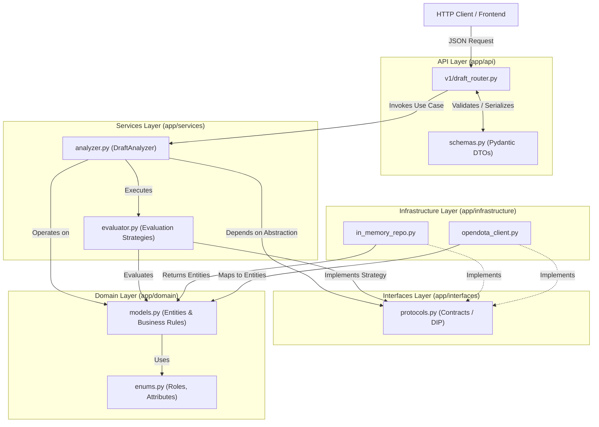

# Dota2DraftAnalyzer

**Dota2DraftAnalyzer** is a draft analysis engine and hero pick recommender for **Dota 2**, built in Python with **FastAPI** using a layered Clean Architecture that applies **Object-Oriented Programming (OOP)**, **SOLID Principles**, and **Design Patterns**.

---

## Project Architecture

The system follows **Clean Architecture / Hexagonal Architecture** principles, ensuring that core domain business rules remain completely independent of web frameworks, databases, or external APIs.

```
Dota_Analyzer/
├── app/
│   ├── domain/
│   │   ├── __init__.py
│   │   ├── enums.py            # Domain enumerations (Roles, Attributes, Factions)
│   │   └── models.py           # Pure entities and aggregates (Hero, DraftState, Matchup)
│   ├── interfaces/
│   │   ├── __init__.py
│   │   └── protocols.py        # Abstract contracts (HeroRepository, EvaluationStrategy)
│   ├── services/
│   │   ├── __init__.py
│   │   ├── analyzer.py         # Use case / Draft analysis orchestrator
│   │   └── evaluator.py        # Strategy pattern implementations for scoring picks
│   ├── infrastructure/
│   │   ├── __init__.py
│   │   ├── in_memory_repo.py   # In-memory repository for testing and local data
│   │   └── opendota_client.py  # Adapter for fetching data from the OpenDota API
│   └── api/
│       ├── __init__.py
│       ├── schemas.py          # Pydantic models (Input/Output DTOs)
│       └── v1/
│           ├── __init__.py
│           └── draft_router.py # HTTP endpoints with dependency injection
├── tests/
│   └── __init__.py             # Unit tests for domain and services using pytest
├── requirements.txt
└── README.md
```

---

## Layer Responsibilities

### 1. Domain Layer (`app/domain/`)
Contains the core business logic with **zero external dependencies** (relies strictly on the Python standard library).
- **`enums.py`**: Defines type-safe enumerations for Dota 2 concepts such as primary attributes (`STRENGTH`, `AGILITY`, `INTELLIGENCE`, `UNIVERSAL`), positional roles (`CARRY`, `MIDLANER`, `OFFLANER`, `SOFT_SUPPORT`, `HARD_SUPPORT`), and attack types (`MELEE`, `RANGED`).
- **`models.py`**: Models core entities (`Hero`, `Draft`, `TeamComposition`) and enforces business invariants (e.g., maximum of 5 heroes per team, preventing duplicate or banned heroes from being picked).

### 2. Interfaces Layer (`app/interfaces/`)
Defines abstract contracts using `Protocol` or `ABC`, applying the **Dependency Inversion Principle (DIP)**.
- **`protocols.py`**: Specifies the interfaces required by the application services layer (`HeroDataProvider`, `DraftEvaluationStrategy`), decoupling application logic from concrete data sources and allowing new evaluation strategies to be added without modifying existing code (**OCP**).

### 3. Services / Application Layer (`app/services/`)
Orchestrates system use cases by combining domain entities and abstract interfaces.
- **`evaluator.py`**: Implements the **Strategy Pattern** to evaluate candidate hero picks across multiple criteria (e.g., *CounterPickStrategy*, *SynergyStrategy*, *RoleBalanceStrategy*) alongside a **Composite/Weighted Evaluator** to aggregate scores.
- **`analyzer.py`**: Coordinates data retrieval from the injected repository, executes evaluation strategies across available heroes, and generates a ranked list of justified pick recommendations.

### 4. Infrastructure Layer (`app/infrastructure/`)
Implements concrete technical details and adapters that fulfill the contracts defined in `app/interfaces/`.
- **`in_memory_repo.py`**: Fast in-memory implementation of the hero and matchup statistics repository, ideal for local development and deterministic unit testing.
- **`opendota_client.py`**: HTTP adapter responsible for querying real-world statistics from the OpenDota API and mapping them into domain entities.

### 5. API / Presentation Layer (`app/api/`)
Exposes application functionality externally over REST using **FastAPI**.
- **`schemas.py`**: Defines *Data Transfer Objects (DTOs)* using **Pydantic** to validate incoming HTTP payloads and serialize responses without coupling internal domain entities to the API contract.
- **`v1/draft_router.py`**: Defines REST endpoints (e.g., `POST /api/v1/draft/analyze`), manages HTTP status codes, and injects dependencies into `DraftAnalyzerService`.

### 6. Tests (`tests/`)
Automated test suite built with **Pytest**, focused on verifying domain invariants, isolated evaluation strategies, and application use cases using mocks or in-memory repositories.

---

## Architecture & Data Flow Diagram



---

## Applied SOLID Principles & Design Patterns

| Principle / Pattern | Application in Project |
| :--- | :--- |
| **SRP (Single Responsibility)** | Strict separation between HTTP validation (`schemas.py`), draft business rules (`models.py`), heuristic scoring (`evaluator.py`), and data access (`infrastructure/`). |
| **OCP (Open/Closed)** | New analysis criteria (e.g., *MetaWinrateStrategy* or *LaneDominanceStrategy*) can be added by creating a new class implementing the strategy interface without modifying `DraftAnalyzer`. |
| **LSP (Liskov Substitution)** | `InMemoryHeroRepository` and `OpenDotaClient` are transparently interchangeable within the analyzer service. |
| **ISP (Interface Segregation)** | Small, focused contracts in `protocols.py` separating hero retrieval, matchup queries, and scoring strategies. |
| **DIP (Dependency Inversion)** | High-level modules (`services`) depend strictly on abstractions (`interfaces`), never on concrete implementations (`infrastructure`). |
| **Strategy Pattern** | Encapsulates interchangeable and composable hero pick evaluation algorithms at runtime. |
| **Repository & Adapter Patterns** | Abstracts data persistence/retrieval and adapts external API responses (OpenDota) to the internal domain model. |

---

## Quick Start & Installation

1. **Create a virtual environment and install dependencies:**
   ```bash
   python -m venv .venv
   source .venv/bin/activate
   pip install -r requirements.txt
   ```

2. **Run unit tests:**
   ```bash
   pytest
   ```
